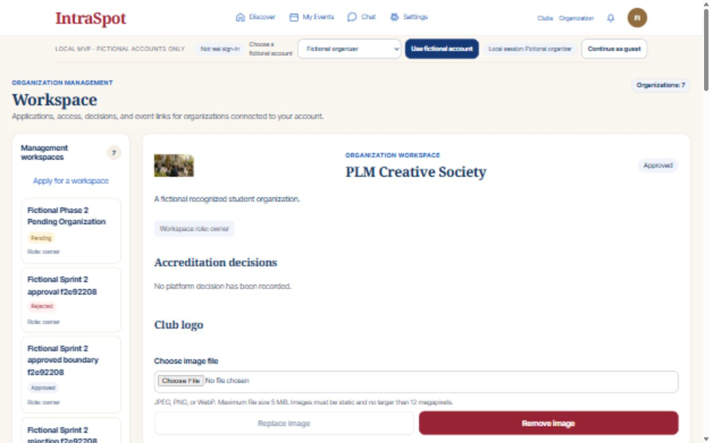
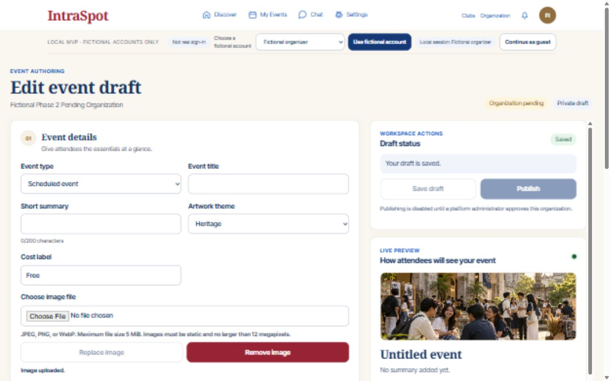
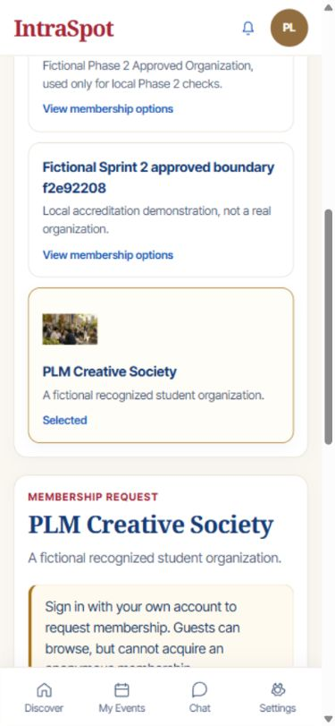

# Sprint 16 acceptance — persistent local media

**Status:** Complete locally, 2026-10-19. Developer evidence only; no deployment,
participant sign-off, physical-device gate, or new commit/push.

## Delivered

- Authorized event-draft banners and organization logos: upload, replacement,
  removal, private preview, public display, and persistent local storage.
- Raw JPEG/PNG/WebP input capped at 5 MiB/12 megapixels; decoded format checking,
  rejection of animation/corruption/spoofing, EXIF orientation, metadata stripping,
  aspect-ratio-preserving WebP normalization up to 2048px without upscaling.
- Current eligible owner/admin authorization, pending preparation, rejected
  read-only behavior, draft-only event mutations, communication restrictions,
  version conflicts, and current-attachment authorization on every image read.
- Responsive existing artwork/logo presentation and localized accessible uploader
  states. Draft editing/autosave/reload/publishing cannot race a media mutation.
- Additive `mvp_0011`, isolated fixture/real/test roots, reviewed OpenAPI and
  generated frontend types. Pillow is pinned to 13.0.0 in both lock exports.

## Verification results

| Check | Actual result |
|---|---|
| Full default PostgreSQL regression | 498 passed, 5 failed initially, 10 skipped; failures were exact pre-media projection-field expectations |
| Corrected projection regressions | All 5 passed on serial rerun; only test expectations changed after the full run |
| Combined default regression result | All 503 non-opt-in cases passed across the full run plus corrected rerun |
| New media/codec/storage/infrastructure cases | 26/26 passed in the full run |
| Isolated synthetic Supabase authentication regression | 50/50 passed against `intraspot_real_dev_test` |
| Frontend Node checks | 86/86 passed |
| Default static build and public-credential guard | Passed |
| Real-profile static build and public-credential guard | Passed |
| Focused ESLint on changed frontend implementation | Passed |
| Explicit upgrade/data preservation | All 26 pre-existing tables unchanged: 70 fixture rows and 2 real-development rows |
| Runtime readiness | 8001 and 8011 both returned ready on `mvp_0011` |
| Actual desktop and mobile browser media checks | Passed as described below |
| Diff whitespace check | Passed; ordinary Windows line-ending warnings only |

The ten skipped tests are existing opt-in browser gates from Sprints 5–14, not
failed media checks. This sprint did not rerun all historical browser scenarios.
The suites retain an existing Starlette/httpx deprecation warning. Auth regression
uses fictional protocol fixtures, not a live Google/PLM-account session.

Local diagnostic reports (ignored, no secret contents published):
`Code/Backend/.cache/s16-regression.xml`, `s16-recheck.xml`, `s16-auth.xml`.
Scratch PostgreSQL suites ran serially. No SQLite locking substitute was used.

## Live browser evidence

Used existing fictional workspaces only; no new organization/event was created
or published. Selected the repository's non-personal heritage JPEG through the
actual file chooser, then explicitly uploaded it through the application.

1. The approved PLM Creative Society workspace accepted a club image, showed it,
   and exposed replacement/removal controls.
2. An existing pending organization accepted an image on its existing private
   draft. Fields disabled during upload, the result became Saved, the loaded
   preview remained private, and publishing stayed disabled while pending.
3. Restarted API 8001, reopened the private draft and observed a decoded 960×540
   preview through a temporary Blob URL. Anonymous approved-logo reads still
   returned identical bytes after restart (WebP/nosniff/private,no-store).
4. As a guest at 390×844, the club directory loaded the uploaded image and retained
   Discover/My Events/Chat/Settings. Document scroll width was 375px within the
   390px viewport: no horizontal overflow.
5. Removed both temporary attachments through the UI and restored the draft's
   original empty theme. A final aggregate hash check still matched all existing
   rows in both development databases. Viewport emulation was reset.

Public uploaded-banner publication/access was verified by PostgreSQL API tests,
not by publishing an additional browser demonstration event. Automated checks
also cover denied roles/cross-org access, pending/rejected/private reads, stale
versions, replacement/detachment, bounded streaming, missing files, immutable
published events, rollback preservation, and file-name collisions.

## Defects resolved during integration

- Replaced Windows-denied hard links with an exclusive UUID reservation followed
  by atomic file replacement; collisions and failed installs preserve old files.
- Flush new media records before attaching their foreign-key pointers.
- Prevented small-image upscaling and retained orientation/metadata checks.
- Blocked draft autosave/media overlap synchronously, not only after React rerender.
- Isolated the media test package to prevent a duplicate `test_access` collection
  collision. Updated old current-head assertions for `mvp_0011` and strict public
  projection assertions for only the newly approved nullable media URLs.
- Corrected rollback-test expectations to the application's controlled HTTP 500
  while preserving its previous-database-pointer/file checks.

## Operations and remaining gates

- Back up the database **and its corresponding media root together**. Default root:
  `Code/Backend/.local/media/{fixture|real}/{local|test}`. `MEDIA_ROOT` may supply an
  absolute base; configuration appends the identity/environment partition. Files
  are not publicly static-mounted. Generated files, tokens and settings stay ignored.
- Explicit migration only. Empty-schema downgrade is tested; downgrade refuses a
  populated media table rather than silently deleting media history.
- Detached/replaced and rolled-back files remain inaccessible but can accumulate
  locally. Cleanup/reconciliation and storage quotas are not implemented. Resolve
  these and server-side abuse controls before public hosting/untrusted traffic.
- Cloud storage, personal profile photos, attachments and remote image ingestion
  remain out of scope. No Supabase application storage/SQL or Penpot change.
- Personal Google sign-in was verified before this sprint; live PLM-account
  sign-in remains pending despite synthetic eligibility tests passing.
- Participant, native-device, security/operational release checks remain open.
  Sprint 17 saved events/calendar/list/conflict warnings is next, not implemented.

See [contract](../backend/Sprint-16.md), [interaction handoff](../design/sprint16-interaction-handoff.md),
and [worker quality review](sprint16-quality-review.md).
