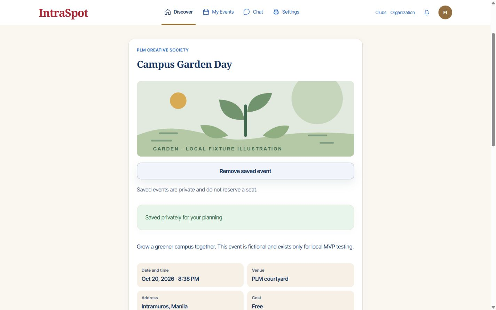
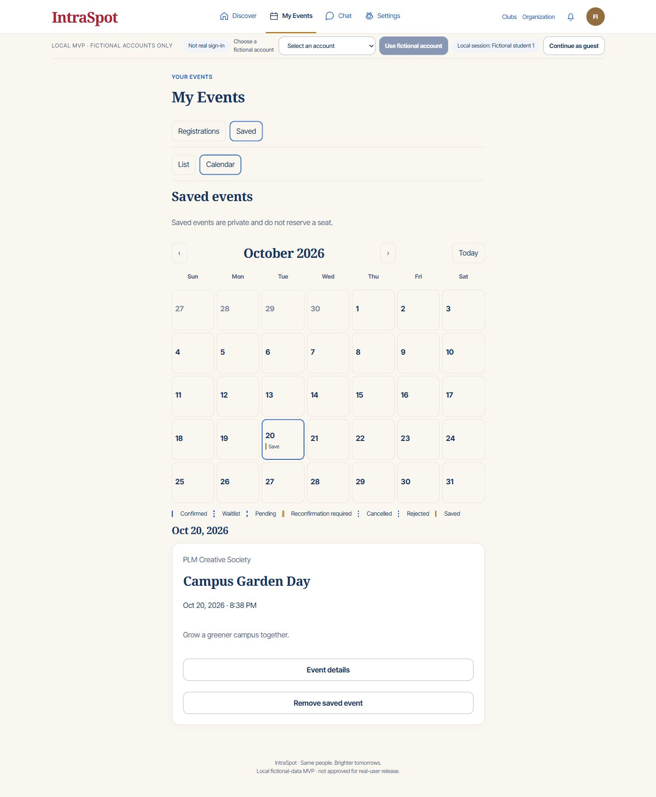
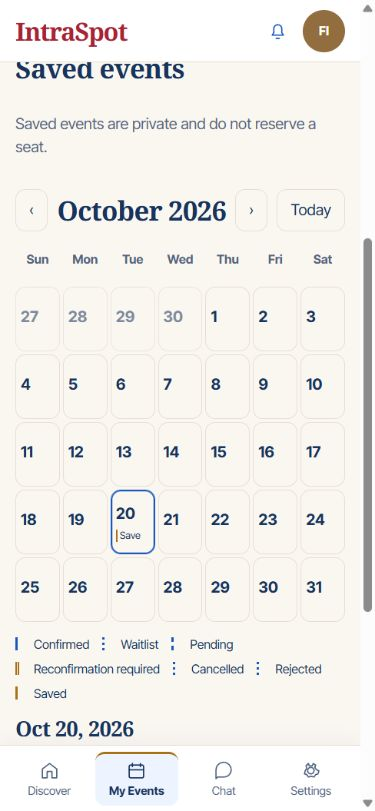

# Sprint 17 acceptance — personal event planning

**Status:** Complete locally, 2026-10-20. Main chat orchestrated three disjoint
Luna/max workers (planning API, planning UI, quality review); all are closed.
No deployment, cloud writes, Penpot update, commit/push, or Sprint 18 execution.

## Delivered

- Private account-scoped saved events with idempotent save/remove, original save
  time on retry, and unavailable-item redaction/removal. Saving is independent
  of registration, eligibility for attendance, reactions, and capacity.
- Registrations/Saved sections and List/Calendar switch inside My Events; list
  remains the default and all four existing registration tabs/actions remain.
- Manila month/day views, cross-midnight intervals with exclusive end, keyboard
  day focus, textual status legend, light dotted waitlist treatment, and normal
  day-detail actions. Public/attendee mobile navigation remains four destinations.
- Private advisory conflict API and UI in event details, registration confirmation,
  and the confirmed My Events section. Only the caller's current confirmed events
  count; touching times, self, ended and non-confirmed records do not conflict.
- Explicit additive `mvp_0012`, reviewed OpenAPI/generated types, bilingual messages,
  account/query-keyed snapshots, abortable private requests, and no new dependency.

## Actual checks

| Check | Result |
|---|---|
| Wider default PostgreSQL regression, excluding new planning tests | 505 passed, 10 existing opt-in browser gates skipped |
| Final new planning PostgreSQL tests | 15 passed, including concurrency, persistence, redaction, visibility, overlap and bounded queries |
| Final browser-request/CORS and foundation checks | 10 passed; one new test, nine repeated foundation checks |
| Unique passing default PostgreSQL cases across these runs | 521 |
| Isolated synthetic Supabase authentication tests | 50 passed |
| Full frontend Node checks | 92 passed |
| Focused TypeScript and ESLint on changed implementation | Passed |
| Default static build and credential scan | Passed |
| Separate real-auth static build and credential scan | Passed |
| Explicit migration preservation | All 27 pre-existing tables unchanged: 72 fixture rows and 2 real-development rows |
| Runtime readiness | APIs 8001 and 8011 ready on `mvp_0012` |
| Live browser planning journey | Passed, as described below |
| Whitespace/diff check | Passed |

Scratch PostgreSQL suites ran serially. No SQLite locking substitute. Existing
Starlette/httpx and Node module-type warnings remain non-blocking. The ten skipped
items are opt-in historical browser suites from Sprints 5–14, not failed Sprint 17
checks. Auth tests use synthetic trusted-provider responses, not live Google/PLM
sessions. Ignored diagnostic reports: Backend/.cache/s17-regression.xml,
s17-planning.xml, s17-cors.xml and s17-auth.xml.

## Live browser journey

Used the existing Fictional student 1/2 accounts and existing Campus Garden Day;
no organization, event, membership, registration, or reaction was created.

1. Saved the public event through its actual detail control. The result explicitly
   said it was saved privately and did not reserve a seat. Displayed counts stayed
   Interested 12 / Confirmed 1 / Reserved 0 / Remaining 0.
2. Opened My Events → Saved. The actual API-backed item appeared in list and
   calendar, with its Manila date and detail/remove actions.
3. At 1440×900, arrow-right moved selection **and actual DOM focus** from October
   20 to October 21; arrow-left restored October 20 and its day details.
4. At 390×844, document scroll width was 375px; at 320×740 it was 305px. No
   horizontal overflow. Mobile navigation remained Discover/My Events/Chat/Settings.
5. Switched to Fictional student 2: its Saved list was empty. Switching back to
   student 1, restarting API 8001 and reloading the page retained the saved item.
6. Removed the temporary bookmark through the calendar. Saved became empty, and
   the development saved_events table returned to zero rows. No preference values
   or pre-existing application rows were changed; final preservation hashes match.
7. Signed out: private My Events content disappeared. Public details remained
   browsable, with sign-in guidance for saving and conflict checks. Viewport override
   was reset and the working public app left available.

## Defects found and resolved

- Direct public event details lacked the approved-organization guard already used
  by discovery/planning. Pending/rejected published records now return controlled
  404s, with regression tests retained.
- The actual browser save exposed a missing `PUT` in CORS methods: preflight
  returned 400 "Disallowed CORS method" although API tests passed. Added PUT while
  retaining the exact local origin allowlist and required authentication; tested
  allowed and untrusted origins and successfully repeated the browser save.
- Batched saved-event/public attendance projections rather than issuing three
  queries per bookmark. A mixed visible/unavailable eight-item regression enforces
  a fixed query ceiling, including authentication overhead.
- Corrected keyboard movement to focus the newly selected calendar date; compact
  markers retain full accessible labels and a textual legend at narrow widths.
- Fixed a residual stale ref name caught by TypeScript. Current private requests
  remain account/query-keyed and abort on cleanup; current builds/type checks pass.
- Corrected an initial test assertion: saving itself must not advance admission
  order, but a deliberately rejected registration attempt may correctly do so.
  Existing durable receipt semantics were preserved, not rewritten to satisfy it.
- Windows denied deletion/creation inside generated build output. Preserved the old
  and partial .next directories recoverably in Frontend/.cache/next-s17-recovery-20261020
  and its -2 sibling; a clean build outside the sandbox passed. No source/export or
  database reset was performed.

## Evidence boundaries and remaining release work

- Positive conflict/status exclusion scenarios, unavailable saved references,
  concurrent retries and overnight/boundary cases are API/pure-helper tests. The
  live browser journey observed an empty conflict result, not a fabricated positive
  conflict or newly registered attendee. No legacy HTML draft substituted for it.
- English desktop/mobile views were observed live. Filipino literal/placeholder
  coverage passed; this sprint did not perform a live extra-large-text/Filipino/
  dark/contrast matrix, physical-device or participant validation. Do those before
  claiming accessibility or release approval; CSS uses existing theme/rem tokens.
- Event status currently supports draft/published, not a new cancelled-event
  lifecycle. Cancelled registration exclusion is tested. Do not infer new organizer
  cancellation behavior from bookmark unavailability.
- Saved lists use batched reads but return the whole private collection. Assess
  pagination/payload bounds and operational abuse controls before large-scale hosting.
- Personal Google sign-in remains verified from Sprint 15; live PLM-account sign-in
  is still pending. Supabase remains Auth-only; application SQL/media remain local.
  Sprint 16 storage reconciliation/quotas and other security/release gates remain open.
- No export/sync/reminders, automatic conflict resolution, mobile management,
  deployment or GitHub push. Sprint 18 persona controls/blocking is next, not built.

See [contract](../backend/Sprint-17.md), [interaction handoff](../design/sprint17-interaction-handoff.md),
and [worker review](sprint17-quality-review.md).
